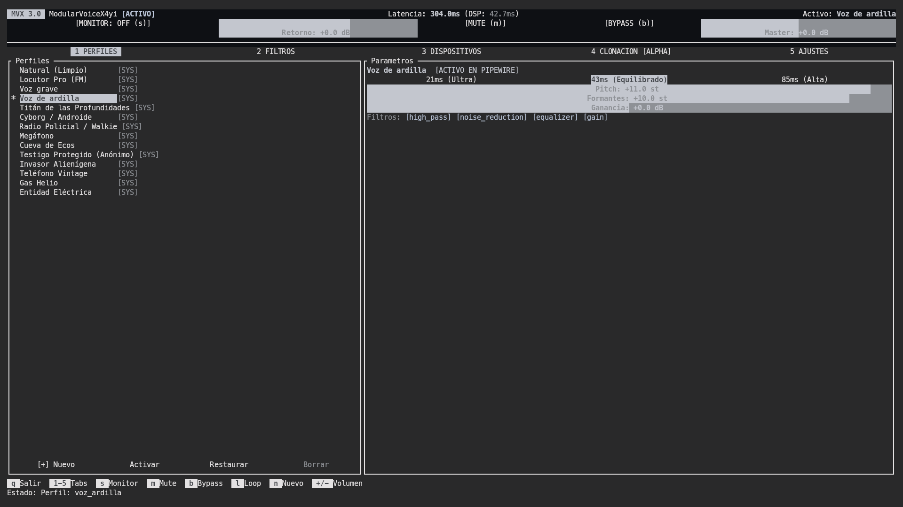

# MVX · ModularVoiceX4yi

**Tu micrófono físico convertido en un estudio vocal en tiempo real sobre PipeWire.**

MVX nace para cubrir un hueco clásico en Linux: modular la voz, limpiar ruido de fondo con redes neuronales, ecualizar, procesar la señal,  Corre como un daemon nativo en Rust (`mvxd`), expone un micrófono virtual (`mvx_mic`) y se controla desde una TUI rápida o por atajos de teclado.

> [!NOTE]
> **Proyecto construido con IA:** Tanto la arquitectura en Rust como el motor DSP, la integración ONNX y la documentación fueron desarrollados con asistencia de inteligencia artesanal, asi que no garantizo calidad en el codigo, sin embargo me esfuerszo para que corra bien.

> [!WARNING]
> **Clonación de voz en estado ALPHA:** La transferencia de timbre neuronal (OpenVoice V2) está en una etapa muy temprana. Es exigente con la CPU, añade latencia (~250 ms+) y el parecido varía según la muestra.

<!-- Capturas del proyecto: colocar en docs/assets/ -->
<p align="center">
  
</p>

---

## Qué ofrece

- **Rack DSP en tiempo real (<15 ms):** Pitch y formantes independientes (Signalsmith Stretch), EQ de 3 bandas, compresor, puerta de ruido, robotizer, ring-mod, distorsión, chorus y reverb.
- **Supresión de ruido neuronal:** DeepFilterNet3 ejecutado en CPU para limpiar teclado, ventiladores y ruido eléctrico sin recortar tu voz.
- **Biometría vocal ("Solo mi voz"):** Verificación del hablante con CAM++ y Silero VAD para que el micrófono solo se abra cuando hablas tú.(falta mejorar su implementacion)
- **Clonación de timbre [ALPHA]:** Extrae la huella vocal (256 dimensiones) desde un audio `.ogg/.wav/.mp3` y modula tu voz hacia ese timbre con OpenVoice V2.
- **Control total desde teclado:** TUI compatible con ratón, CLI (`mvx ctl`) para atajos en Hyprland/Sway/KDE y salida JSON directa para Waybar.

---

## Requisitos del entorno

Pensado para cualquier distribución **Linux x86_64** que cumpla con:

- **Audio:** **PipeWire** + **WirePlumber** activos (no soporta PulseAudio ni JACK puros).
- **Sistema:** `git`, `clang`, `cmake`, `pkg-config`, headers de `libpipewire-0.3` y `libspa-0.2`, `ffmpeg` y `curl`.
- **Toolchain:** Rust `>= 1.96` (el instalador lo descarga con `rustup` si no lo tienes).
- **Hardware:** CPU con **AVX2** recomendado y mínimo **2 GB de RAM**.

---

## Instalación

Por ahora MVX no se distribuye en paquetes precompilados. Se instala clonando el repositorio con `git`; el script se encarga de revisar dependencias, compilar en modo `release`, instalar los binarios en `~/.local/bin`, **añadirlos automáticamente a tu `PATH`**(revisar scripts ante desconfianza) y descargar los modelos ONNX (~180 MB):

```bash
git clone https://github.com/X4yii/ModularVoiceX4yi.git
cd ModularVoiceX4yi
./scripts/install.sh
```

Opciones útiles del instalador:

```bash
./scripts/install.sh --fast             # Compila sin LTO (mucho más rápido en CPUs modestas o poca RAM)
./scripts/install.sh --no-clone-models  # Omite los modelos de clonación neuronal (ahorra ~160 MB)
./scripts/install.sh --no-deps          # Si ya instalaste las dependencias de tu distro por tu cuenta
./scripts/uninstall.sh                  # Desinstala binarios y servicios (--purge borra también modelos y configs)
```

---

## Uso rápido

```bash
mvx                                    # Abre la TUI (levanta el daemon mvxd automáticamente)
mvx doctor                             # Verifica PipeWire, modelos, latencia y estado del sistema
mvx ctl toggle-mute                    # Silencia/activa el micrófono (ideal para keybinds)
mvx ctl toggle-bypass                  # Voz natural al instante sin apagar el motor
mvx ctl next-preset                    # Cambia al siguiente perfil de voz
mvx clone muestra.ogg --name "Custom"  # [ALPHA] Crea y activa un perfil clonado desde un audio
```

Al abrir `mvx`, selecciona **`MVX Microphone` (`mvx_mic`)** como dispositivo de entrada en Discord, OBS o tu navegador.

---

## Créditos y Licencia

Construido sobre [PipeWire](https://pipewire.org), [DeepFilterNet](https://github.com/Rikorose/DeepFilterNet), [Signalsmith Stretch](https://github.com/Signalsmith-Audio/signalsmith-stretch), [sherpa-onnx](https://github.com/k2-fsa/sherpa-onnx) (CAM++ / Silero VAD), [tract](https://github.com/sonos/tract) y [OpenVoice V2](https://github.com/myshell-ai/OpenVoice).

Distribuido bajo licencia [MIT](LICENSE).
